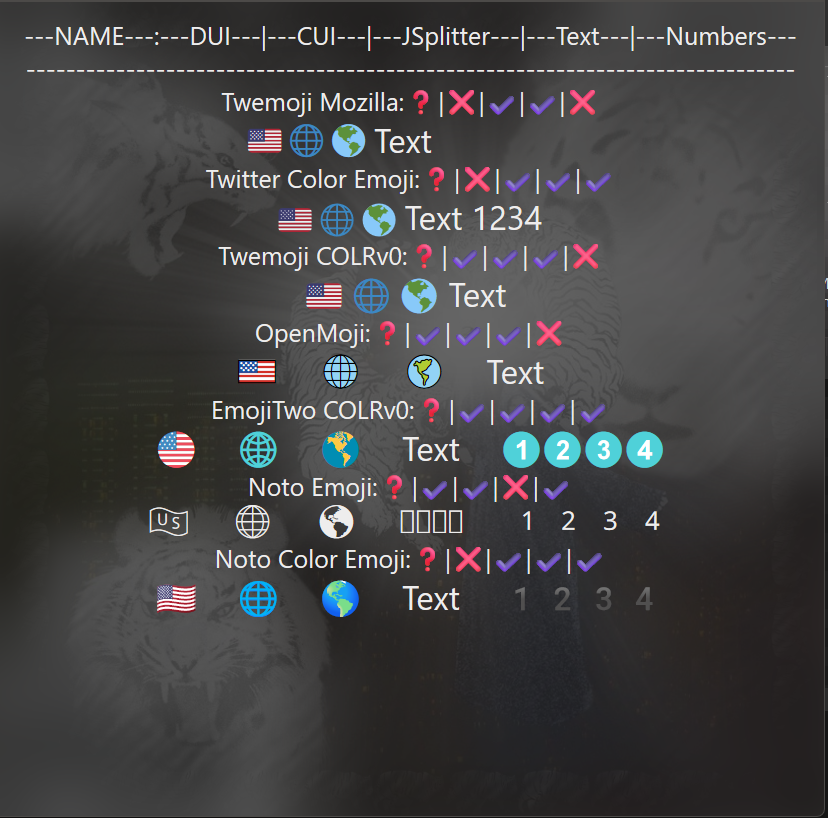

These are the required fonts for all my scripts: filename (font name)
- Arial Unicode MS.ttf (Arial)
- Font Awesome 4.ttf (Font Awesome 4)
- seguisym.ttf (Segoe UI) (*)
- tahoma.ttf (Tahoma)

(*) Segoe UI has multiple versions depending on the OS, chose whatever suits you.

Additionally, I offer a colection of emoji fonts to be used for symbols and country flags: filename (font name)
- twemoji-glyf_colr_0.ttf (Twemoji COLRv0)
- EmojiTwoCOLRv0.ttf  (EmojiTwo COLRv0) (*)
- OpenMoji-color-glyf_colr_0.ttf (OpenMoji)
- NotoColorEmoji-Regular.ttf (Noto Color Emoji)
- NotoEmoji-VariableFont_wght.ttf (Noto Emoji Light)
- Twemoji.Mozilla.ttf (Twemoji Mozilla)
- TwitterColorEmoji-SVGinOT.ttf (Twitter Color Emoji)

(*) EmojiTwo COLRv0 is used as default emoji font on some scripts.

Emoji fonts having double-width space chars can be used as long as spaces are replaced with U+2009 ' ' [Thin Space Unicode Character](https://www.fileformat.info/info/unicode/char/2009/index.html). 

In foobar2000 that means using: `$replace(your text, ,$char(8201))`

To install any font, just double click on .ttf files.

You can download every file one by one or using the following [link](https://download-directory.github.io?url=https://github.com/regorxxx/foobar2000-assets/tree/main/Fonts).
